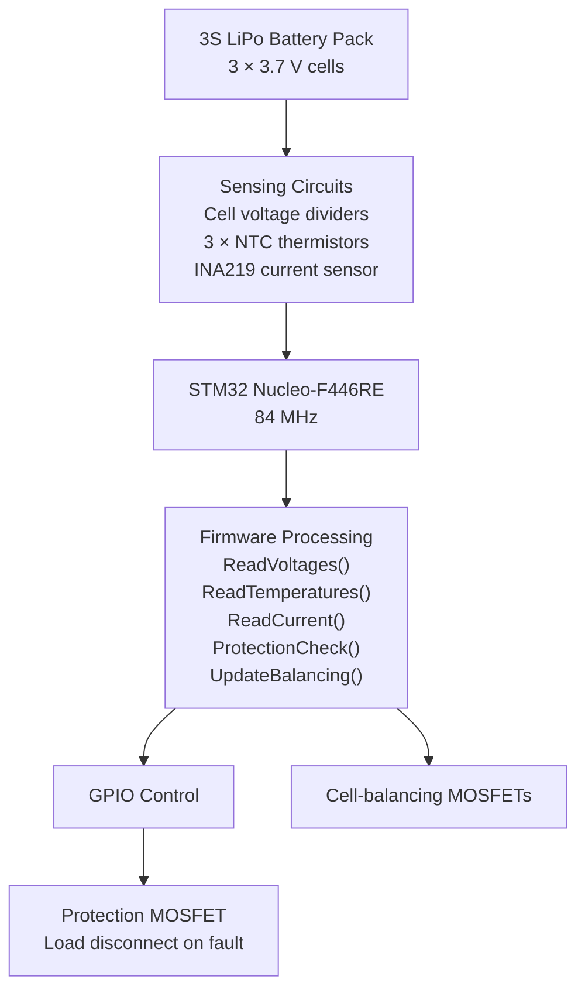

# Battery Management System (BMS)

A discrete 3S LiPo Battery Management System built on perfboard using an STM32 Nucleo F446RE — no dedicated AFE IC. Every sensing and protection function is implemented from scratch using analog front-end circuits and STM32 HAL firmware. The STM32 firmware handles the functions implemented in the BMS, while the ESP32 firmware provides the associated monitoring interface for battery monitoring and management.

## Project Team

- **Aryan K Ail**
- **Ayush Khare**
- **Vartika Mrigwani**
- **Pranati Rao**

*R.V. College of Engineering, Bengaluru*

## System Architecture



## Key Features

- **Per-cell voltage monitoring** via calibrated resistor dividers and STM32 ADC
- **Pack current and power monitoring** via INA219 over I2C
- **Cell temperature sensing** via NTC B3950 thermistors using the Steinhart-Hart equation
- **Under-voltage protection (UVP)** — cuts load if any cell drops below threshold
- **Over-current protection (OCP)** — cuts load on sustained overcurrent with debounce
- **Over-temperature protection (OTP)** — cuts load above trip temperature, auto-recovers on cool-down
- **Passive cell balancing** — bleeds the highest cell when pack spread exceeds 50mV
- **I2C bus auto-recovery** — bit-bang recovery for stuck bus after debug resets

---

## Tech Stack

- **MCU** — STM32 Nucleo F446RE (STM32F446RET6, Cortex-M4)
- **Firmware** — STM32 HAL C, Keil MDK-ARM (µVision)
- **Peripheral config** — STM32CubeMX
- **Sensing** — Resistor dividers, INA219 (I2C), NTC thermistors, IRLZ44N MOSFETs
- **Build** — Discrete perfboard (no AFE IC)

---

## Getting Started

### Prerequisites
- Keil MDK-ARM (µVision 5) with STM32F4 device pack
- STM32CubeMX (optional — for viewing peripheral config)
- ST-Link driver (bundled with Nucleo board)

### Repository Structure

```
BMS/
├── Core/
│   ├── Inc/
│   └── Src/
├── Drivers/
│   ├── CMSIS/
│   └── STM32F4xx_HAL_Driver/
├── MDK-ARM/
├── ESP32_BMS_dashboard/
│   └── ESP32_BMS_dashboard.ino
├── Presentation
├── Phase1.ioc
├── .gitignore
└── README.md
```

### Debug — Keil Watch Window

Add these variables to **Watch window** to monitor everything live:

```
v_cell1  v_cell2  v_cell3
temp_c1  temp_c2  temp_c3
current_A  bus_V  power_W
fault_uvp  fault_ocp  fault_otp  fault_any  fet_on
bal_active1  bal_active2  bal_active3  v_spread
ina219_ok
```

---

## Known Limitations

- Cell 2 and Cell 3 balance FETs require a high-side gate driver for full hardware conduction — balancing logic is complete and visible in firmware but only Cell 1 switches fully in hardware.
- UVP and OCP faults latch and require a power cycle to clear. OTP auto-clears.
- Maximum measurable current is limited by the INA219 shunt range.

---

## Safety Notice

This project is for engineering development and educational use. Always use a current limited bench PSU for initial bring up before connecting real LiPo cells. Verify all divider output voltages with a multimeter before powering, any ADC pin exceeding 3.3V will permanently damage the STM32.

---

